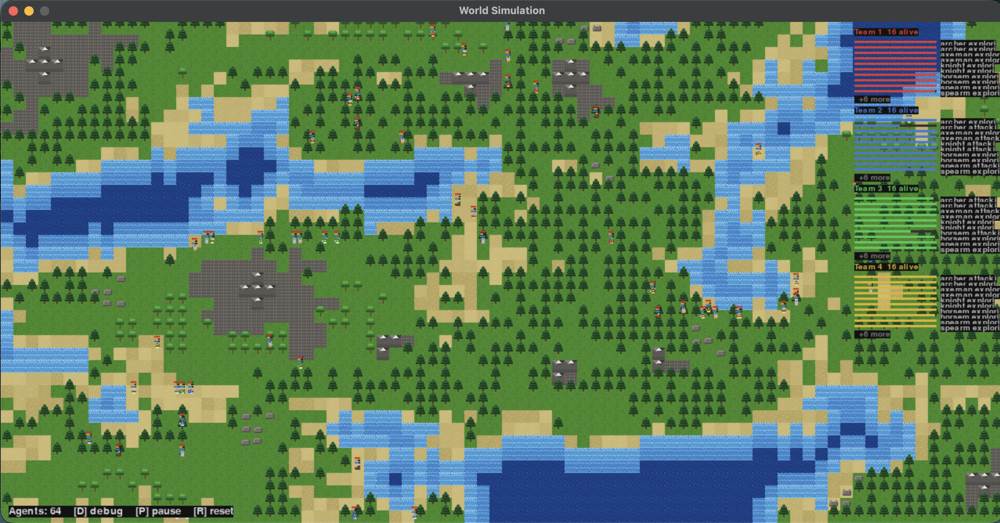

# AutonomousWarfare

AutonomousWarfare is a Python/Pygame autonomous-agent simulation set in a procedurally generated world. Multiple teams of units explore the map, manage survival needs, navigate terrain, and respond to nearby enemies through simple decision-making behaviors.



## How it works

The world is divided into square tiles. Each tile receives two independent Perlin-noise values: elevation and moisture.

For a tile at position `(x, y)`, the project samples normalized noise values in the range `[0, 1]`:

```text
Elevation(x, y) = (Perlin(x · sₑ + oₑₓ, y · sₑ + oₑᵧ) + 1) / 2
Moisture(x, y)  = (Perlin(x · sₘ + oₘₓ, y · sₘ + oₘᵧ) + 1) / 2
```

Here, `sₑ` and `sₘ` control the scale of the terrain patterns, while the offsets `oₑ` and `oₘ` use different random seeds so that moisture patterns do not simply copy elevation patterns.

The normalized values are classified using thresholds:

```text
Elevation < 0.45              → water
0.45 ≤ Elevation < 0.48       → shore
Elevation > 0.61              → highland / mountain candidate

Moisture > 0.60               → oak forest
Moisture < 0.55               → dark pine forest
Otherwise                     → grassland
```

After the initial classification, the generator refines the map by removing very small lakes, calculating water depth from the distance to land, placing mountain clusters, and scattering trees and rocks.

Agents navigate walkable tiles using the **A\*** pathfinding algorithm. A* evaluates each candidate tile with:

```text
f(n) = g(n) + h(n)
```

where `g(n)` is the distance traveled so far and `h(n)` is the Manhattan-distance estimate to the destination:

```text
h(n) = |xₙ - x_goal| + |yₙ - y_goal|
```

Each agent evaluates its surroundings and chooses actions such as exploring, fleeing, attacking, drinking, eating, resting, or trading. Unit behavior and statistics are configured in `game.yaml`.

## Run the project

Install the dependencies:

```bash
pip install -r requirements.txt
```

Then start the simulation:

```bash
python main.py
```

## Controls

- `D` — Toggle debug mode
- `P` — Pause or resume
- `R` — Generate a new world
- Mouse wheel — Zoom
- Left-click and drag — Move the camera

## Main files

- `main.py` — Simulation loop, rendering, input, and agent spawning
- `agents.py` — Agent behavior, needs, combat, and inventory
- `map_generator.py` — Procedural map generation and terrain management
- `pathFinding.py` — A\* pathfinding implementation
- `game.yaml` — Unit and simulation configuration
- `requirements.txt` — Python dependencies
